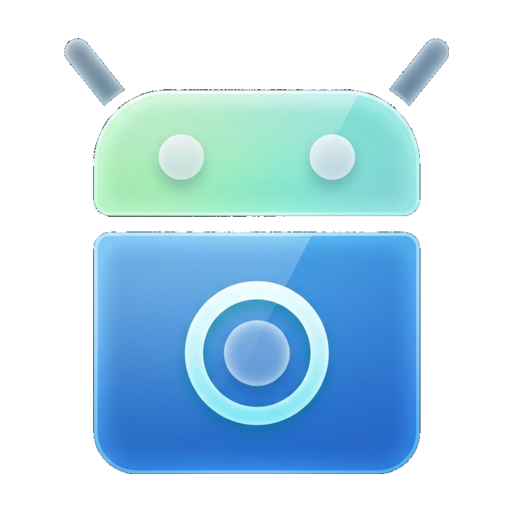
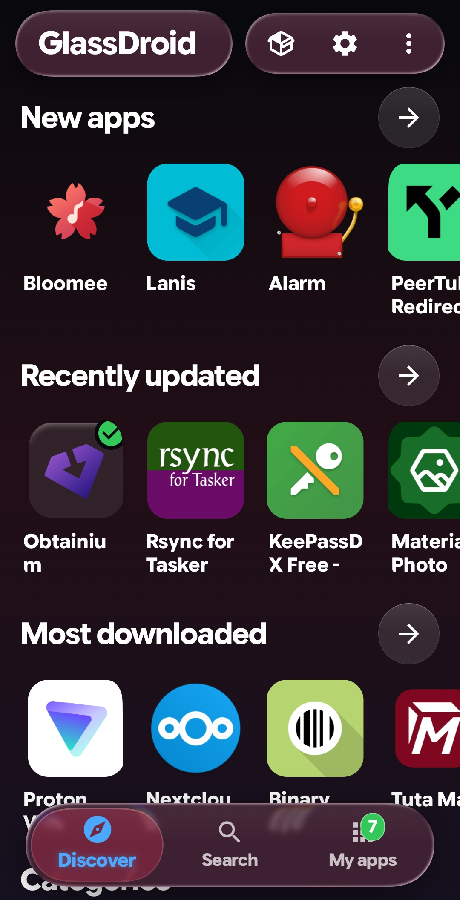
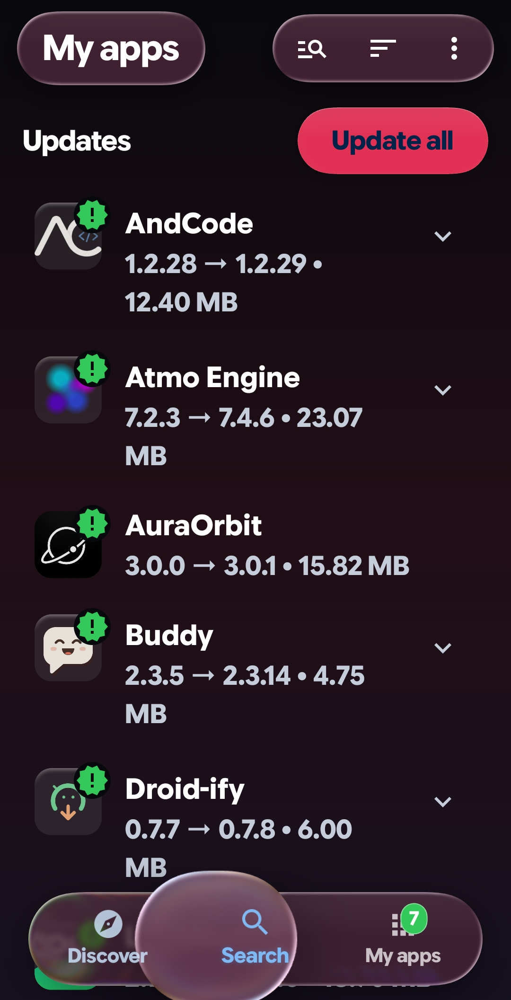
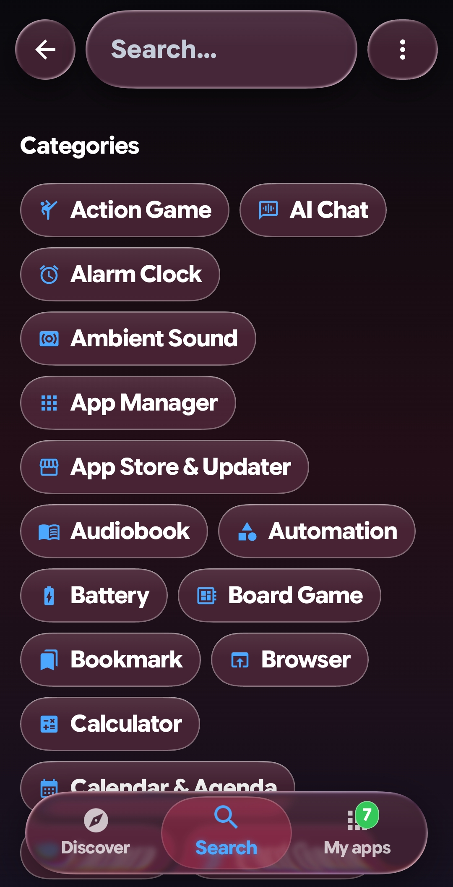
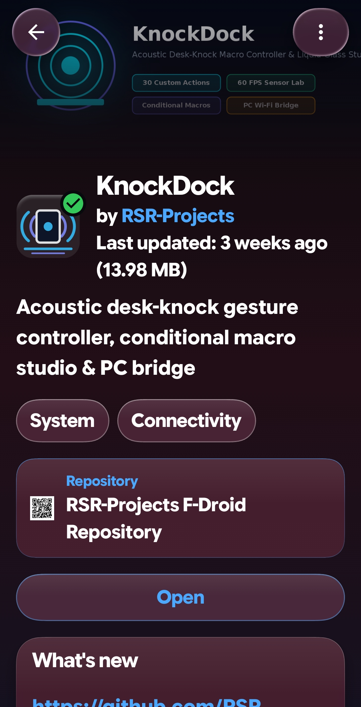
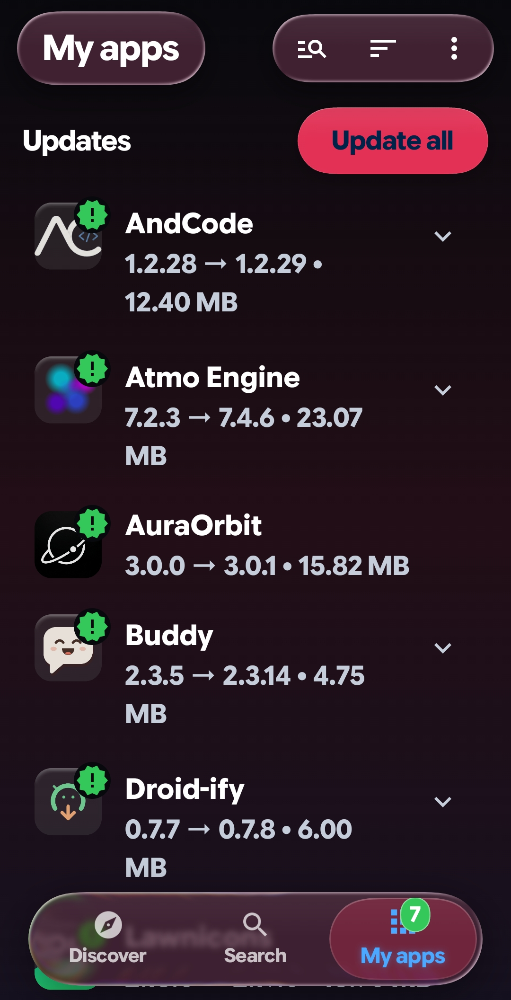
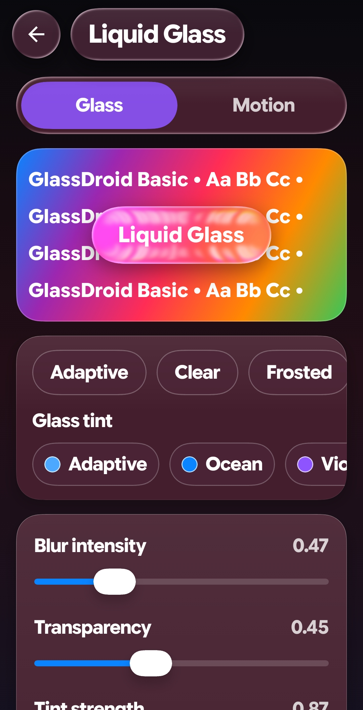
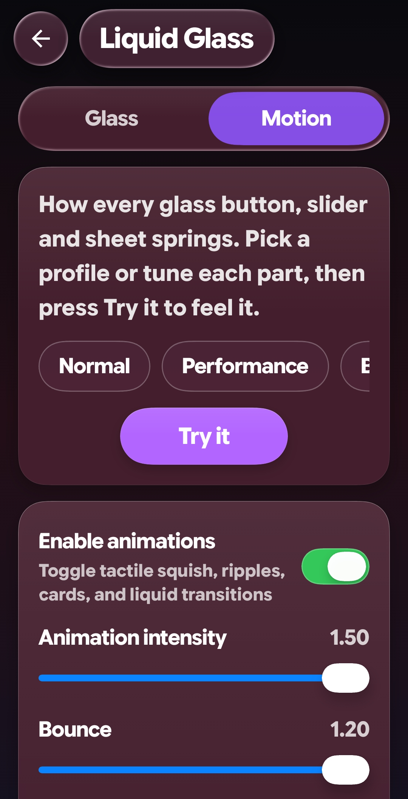
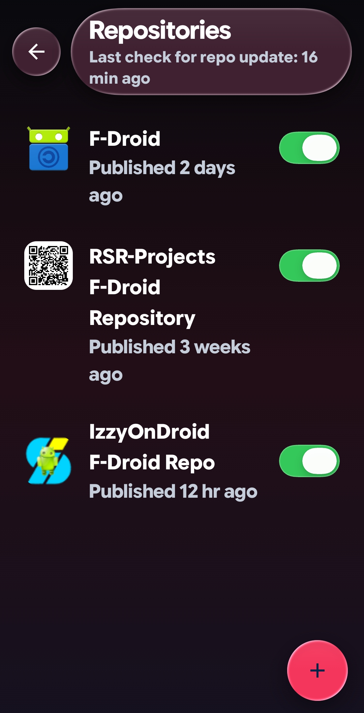
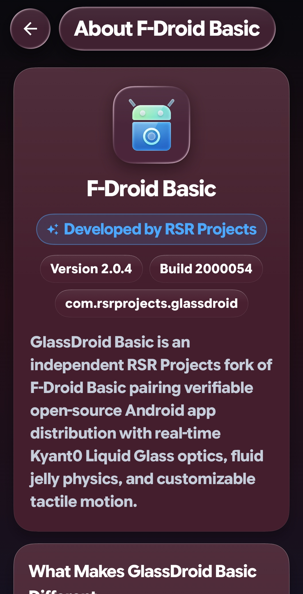

<div align="center">



# GlassDroid Basic

**An independent fork of F-Droid Basic by [RSR Projects](https://rsr-projects.github.io/RSR-FDroid/) featuring an optical Liquid Glass interface and fluid spring physics.**

<p>
  
  
  
  <a href="LICENSE"></a>
</p>

[About](#about) · [Features](#features) · [Screenshots](#screenshots) · [Customisation](#customisation) · [Installation](#installation) · [Development](#development) · [Licence](#credits--licence)

</div>

---

## About

**GlassDroid Basic** (`com.rsrprojects.glassdroid`) is an open-source Android app store client forked from **[F-Droid Basic](https://gitlab.com/fdroid/fdroidclient)** and maintained under **RSR Projects**.

It pairs F-Droid's repository verification, app discovery, and unattended `SessionInstaller` architecture with a refractive Material 3 + **[Kyant0 AndroidLiquidGlass](https://github.com/Kyant0/AndroidLiquidGlass)** interface, spring-driven interactions, and an in-app **Glass & Motion Customizer**.

> **Note:** Consistent with upstream F-Droid Basic, Nearby Share and panic-button features are excluded.

---

## Features

### Optical Liquid Glass & Fluid Motion
- **Real-Time Liquid Glass Surfaces:** Bounded backdrop blur, rounded-corner lens refraction, optional chromatic dispersion, upper-surface light scattering, specular rim highlights, and adaptive tinting.
- **Floating Navigation & Hold-to-Swipe Droplet:** Dual-backdrop floating bottom dock (`Discover`, `Search`, `My Apps`) with hold-and-swipe jelly droplet lens blur over crisp icons/labels, hold-to-open Search shortcut, and adaptive `NavigationRail` on wide screens.
- **Physics & Discovery Animations:** Velocity-reactive elastic squish (`liquidSquish`), radial touch ripples, staggered card entrances, icon pop animations, scroll parallax depth, glass shimmer sweeps, and refractive app-opening portal transitions.
- **Consistent Glass Styling:** Translucent top bars, cards, switches, sliders, radio pickers, proxy/settings dialogs, download progress buttons, and toast notifications.

### F-Droid Basic App Store Core
- **Browse & Global Search:** Categorised Discover feed, app lists, repository filters, and persistent search history.
- **App Details & Downloads:** Permissions, metadata, links, version selector, live download progress, and animated install/error states.
- **Repository & Network Controls:** Add repositories via URL or QR code, automatic updates, mirror selection, HTTP/SOCKS proxy settings, DNS cache toggle, screenshot protection, alternate calculator launcher icon, and debug log export.

---

## Screenshots


<table>
  <tr>
    <td align="center" width="33%">
      <br />
      <sub><strong>1. Discover Feed</strong><br />Floating glass bar &amp; staggered cards</sub>
    </td>
    <td align="center" width="33%">
      <br />
      <sub><strong>2. Jelly Bottom Dock</strong><br />Hold-and-swipe refractive droplet</sub>
    </td>
    <td align="center" width="33%">
      <br />
      <sub><strong>3. Global Search</strong><br />Live filtering &amp; search history</sub>
    </td>
  </tr>
  <tr>
    <td align="center" width="33%">
      <br />
      <sub><strong>4. App Details</strong><br />Parallax banner &amp; download control</sub>
    </td>
    <td align="center" width="33%">
      <br />
      <sub><strong>5. My Apps &amp; Updates</strong><br />Installed apps &amp; update status</sub>
    </td>
    <td align="center" width="33%">
      <br />
      <sub><strong>6. Glass Customizer</strong><br />Presets, tint swatches &amp; live pill</sub>
    </td>
  </tr>
  <tr>
    <td align="center" width="33%">
      <br />
      <sub><strong>7. Motion Customizer</strong><br />Spring profiles, squish &amp; intensity</sub>
    </td>
    <td align="center" width="33%">
      <br />
      <sub><strong>8. Repositories &amp; Settings</strong><br />QR repo manager &amp; glass dialogs</sub>
    </td>
    <td align="center" width="33%">
      <br />
      <sub><strong>9. About Screen</strong><br />RSR Projects branding &amp; licences</sub>
    </td>
  </tr>
</table>

---

## Customisation

Open **Settings → Liquid Glass** to configure visual rendering and physics in real time with a draggable live refraction preview pill:

- **Glass Tab:** Choose **Adaptive**, **Clear**, **Frosted**, **Deep**, or **Custom** presets; pick glass tint swatches (`Adaptive`, `Ocean`, `Violet`, `Emerald`, `Amber`, `Rose`, `Neutral`); tune blur, transparency, tint strength, reflection/highlight intensity, refraction height/amount, vibrancy, brightness, chromatic dispersion, and **Reduced Visual Effects** mode.
- **Motion Tab:** Enable or disable animations globally, pick **Normal**, **Performance**, **Bouncy**, or **Custom** motion profiles, adjust overall **Animation Intensity**, bounce, speed, press depth, release jiggle, drag stretch, and long-press bloom, or tap **Try it**.
- **Restore Defaults:** Separate reset actions restore default Glass or Motion settings, while **Settings** also includes Light/Dark/System themes, app language, notifications, and alternate app icon selection.

---

## Installation

> Signed public release APK is published under **[GitHub Releases](https://github.com/RSR-Projects/GlassDroid/releases)** 

1. Download the signed `app-release-*.apk` asset from the official GitHub Release.
2. Open the APK on your Android device (Android 7.0 / API 24 or newer) and allow **Install unknown apps** for your browser or file manager if prompted.
3. Verify repository fingerprints inside **Repositories** if adding third-party F-Droid mirrors.

---

## Development

- **Repository:** [https://github.com/RSR-Projects/GlassDroid](https://github.com/RSR-Projects/GlassDroid)
- **Project Website:** [https://rsr-projects.github.io/RSR-FDroid/](https://rsr-projects.github.io/RSR-FDroid/)
- **Package ID / Versions:** `com.rsrprojects.glassdroid` · `versionName` `2.0.4` (`versionCode` `2000054`) · `minSdk 24` · `targetSdk 36` · `compileSdk 37`

### Project Structure

| Module / Directory | Purpose |
| --- | --- |
| `app/` | Android application, Liquid Glass UI (`org.fdroid.ui.glass`), navigation, settings, and About screen |
| `libs/core`, `libs/index`, `libs/database`, `libs/download` | Multiplatform F-Droid core, repository index, Room database, and HTTP downloader libraries |
| `libs/sharedTest` | Shared test utilities for unit and Robolectric suites |
| `fastlane/metadata/android/en-US/` | Store listing metadata and `phoneScreenshots/` layout |

### Building & Testing

The project targets **Gradle 9.3.1** (`gradle/wrapper/gradle-wrapper.properties`) and **JDK 17**. Because the `gradlew` launcher script is not checked into this repository root, run with system `gradle` (or generate a local wrapper via `gradle wrapper`):

```bash
# Run JVM & Robolectric unit tests
gradle :app:testDebugUnitTest

# Build debug APK
gradle :app:assembleDebug

# Build signed release APK (signing env vars required by app/build.gradle.kts)
KEYSTORE_PATH=/path/to/upload.jks STORE_PASSWORD=... KEY_PASSWORD=... gradle :app:assembleRelease
```

Contributions are welcome — see [CONTRIBUTING.md](CONTRIBUTING.md) and [SECURITY.md](SECURITY.md).

---

## Credits & Licence

- **Upstream Foundation:** Built upon **[F-Droid Basic / F-Droid Client](https://gitlab.com/fdroid/fdroidclient)** by the F-Droid contributors ([f-droid.org](https://f-droid.org)).
- **Key Open-Source Dependencies:** Kyant0 `backdrop` (`2.0.1`) & `capsule` (`2.1.3`), Jetpack Compose, Material 3, Navigation 3, Kotlin / Coroutines / `kotlinx.serialization`, Dagger Hilt, Molecule, Coil 3, Ktor & OkHttp, Room, `compose-preference`, `compose-hints`, ZXing, SLF4J / Logback-Android, and upstream CC-BY 3.0 / 4.0 icon contributors.

**Licensing:**
- The Android application (`app/`) is Free Software licensed under the **[GNU General Public License v3.0 or later](LICENSE)**, preserving all original upstream copyright notices.
- The reusable libraries under `libs/` are licensed under the **[Apache License 2.0](libs/LICENSE)**.
